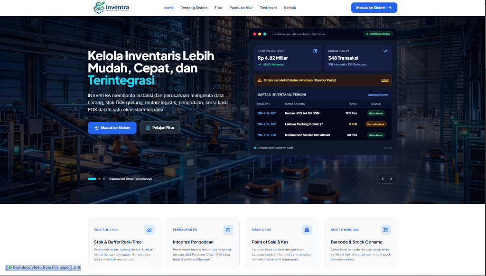
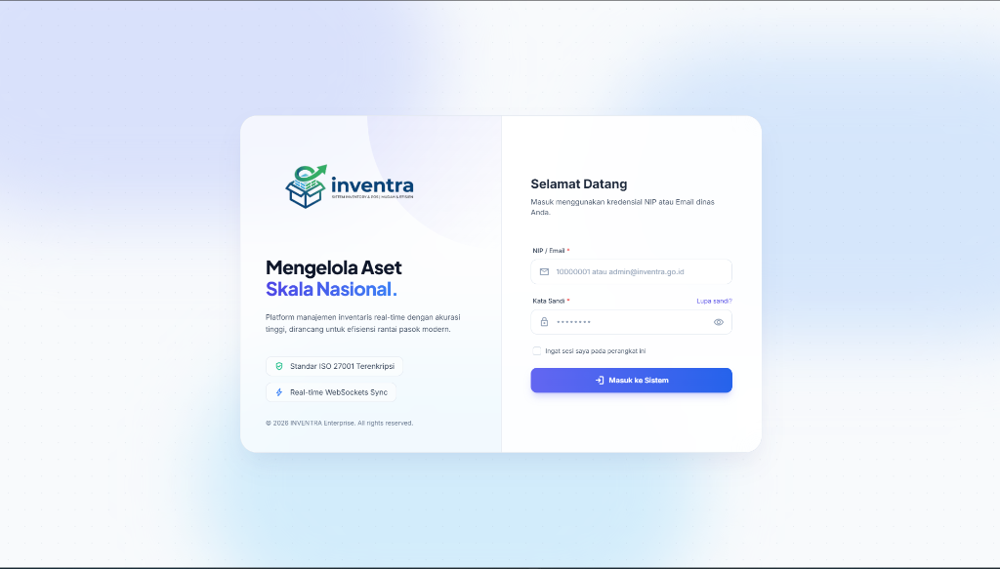
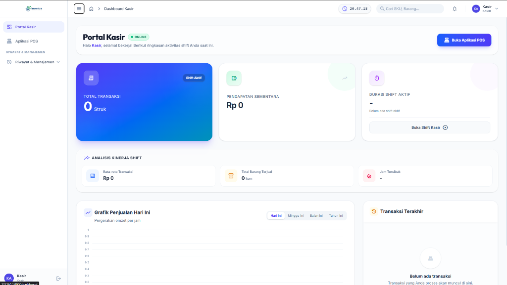
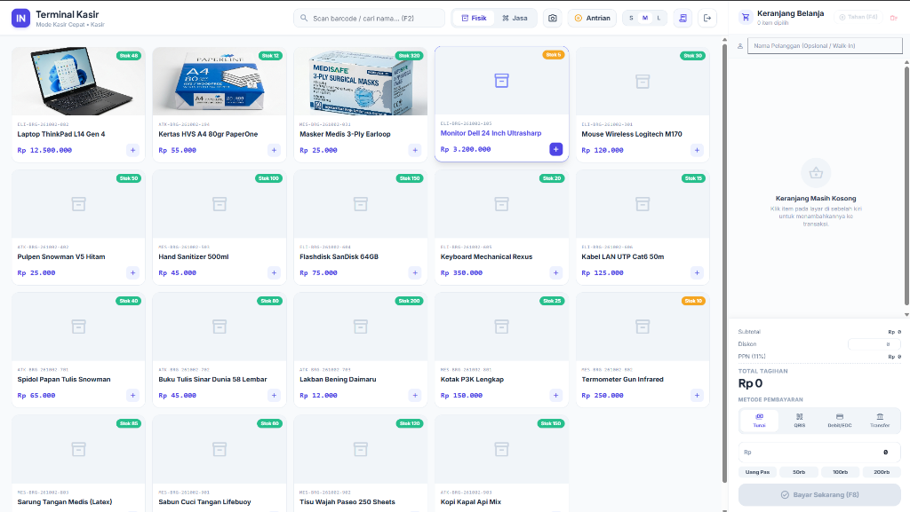

<div align="center">
  

  # 📦 INVENTRA Enterprise ERP
  
  <p>
    <strong>Sistem Informasi Manajemen Logistik, Inventaris Terintegrasi, & Point of Sale (POS) Modern berbasis Web dengan Laravel.</strong>
  </p>

  <p>
    
    
    
    
    
  </p>
</div>

---

## 📖 Tentang INVENTRA

**INVENTRA** adalah platform Enterprise Resource Planning (ERP) dan manajemen logistik terpadu yang dirancang untuk mengelola tata kelola persediaan barang di gudang, pengadaan (*purchasing*), akuntabilitas audit, serta terminal transaksi **Point of Sale (POS)** di lini terdepan secara *real-time*.

Sistem ini menerapkan arsitektur *Role-Based Access Control* (RBAC) ketat dengan pemisahan hak akses, alur kerja (*approval workflow*), serta antarmuka yang responsif dan dioptimalkan untuk perangkat Desktop maupun Tablet.

---

## 📸 Tangkapan Layar (Screenshots)

### 1. Beranda


### 2. Halaman Login


### 3. Portal Kasir & Manajemen Shift


### 4. Terminal Kasir (Point of Sale / POS)


---

## ✨ Fitur Utama Berdasarkan Peran (Role-Based Features)

### 1. 🧑‍💼 Modul Kasir (Point of Sale & Shift)
* **Terminal POS Interaktif (Tablet-Ready):**
  * Pemilihan mode transaksi (**Barang Fisik** vs **Layanan Jasa**).
  * Pemindai Barcode Hardware (USB/Bluetooth) & **Pemindai Barcode Kamera (*Webcam Scanner*)** dengan pintasan keyboard `F3`.
  * Keranjang belanja responsif, diskon instan, kalkulasi PPN 11%, dan pembayaran multi-metode (**Tunai, QRIS, Kartu Debit, Transfer Bank**).
  * Fitur **Antrian Pesanan / Tahan & Panggil Keranjang (*Hold & Resume Cart*)** dengan pintasan `F4`.
  * Cetak Struk Nota Penjualan format **Thermal Printer ESC/POS (58mm / 80mm)**.
* **Manajemen Shift & Rekonsiliasi Kas (*Cash Reconciliation*):**
  * Buka shift kasir dengan modal awal (*Starting Cash*).
  * Tutup shift kasir dengan **input kas fisik aktual** & kalkulasi otomatis **Selisih Kas (*Discrepancy: Pas / Lebih / Kurang*)**.
  * **Cetak Struk Rekapitulasi Shift (*Shift Handover Summary Receipt*)** lengkap dengan rincian omzet per metode bayar, volume transaksi, dan kolom tanda tangan kasir & supervisor.
  * Modal peninjauan rincian transaksi per shift (*itemized shift breakdown*).
* **Retur Penjualan (*Sales Returns*):**
  * Pengembalian barang parsial/penuh dari nomor referensi struk dengan pengembalian stok otomatis ke inventaris dan pemotongan omzet shift.

---

### 2. 📦 Modul Admin Gudang (Logistik & Inventaris)
* **Dashboard Operasional Logistik Real-Time:**
  * Metrik 6-Grid: **Total Stok Fisik, Inbound Hari Ini, Outbound Hari Ini, Peringatan Stok Kritis, Barang Karantina/Rusak**, dan **PO Disetujui Siap Diterima**.
  * Pusat Aksi Operasional Cepat (*Quick Action Hub*) & Feed riwayat mutasi barang terkini.
  * Notifikasi *live stream event* dan audio alert via WebSocket Reverb saat ada perubahan stok.
* **Penerimaan Barang (*Inbound* & Integrasi Purchase Order):**
  * Pembuatan transaksi Inbound manual atau **Tarik Otomatis dari Purchase Order (PO) yang Telah Disetujui**.
  * Preview item PO, replikasi daftar barang instan, dan auto-completion PO setelah penerimaan selesai.
* **Pengeluaran Barang (*Outbound*):** Distribusi barang keluar gudang dan pencetakan **Surat Jalan Pengiriman (*Delivery Note*)**.
* **Mutasi Antar Gudang (*Stock Transfer*):** Perpindahan stok fisik antar gudang/cabang/outlet.
* **Stock Opname:** Rekonsiliasi hitung fisik versus sistem dengan kalkulasi selisih (*variance*) dan penyesuaian stok otomatis.
* **Karantina & Barang Rusak (*Damaged Items*):** Pencatatan barang cacat/rusak/expired, isolasi kuantitas dari stok aktif, dan pelacakan status (*Dalam Karantina, Dimusnahkan, Diretur, Selesai*).
* **Cetak Label Barcode:** Generator barcode siap cetak dalam template **Label Rak**, **Barcode Produk**, dan **Lembar A4 Grid**.
* **Request Perubahan Master Data:** Pengajuan usulan koreksi data barang ke manajer.

---

### 3. 🛍️ Modul Purchasing (Pengadaan & Supplier)
* **Manajemen Supplier:** Database vendor lengkap dengan kontak dan katalog produk.
* **Purchase Order (PO):** Pembuatan PO multi-line item, estimasi harga beli, kalkulasi total, dan pengiriman draft.
* **Approval Tracking:** Pemantauan status PO (**Draft, Menunggu Approval, Disetujui, Ditolak, Selesai**).
* **Evaluasi Vendor:** Pemantauan performa vendor dan riwayat pemesanan.
* **Laporan Pengadaan:** Laporan PO per periode dan **Laporan Reorder Point** untuk barang yang menyentuh batas minimum stok.

---

### 4. 👔 Modul Manager (Eksekutif & Pimpinan)
* **Executive KPI Dashboard:** Ringkasan pendapatan, valuasi aset, perbandingan arus keluar-masuk barang, dan audit log terkini.
* **Analisis Tren Penjualan:** Grafik penjualan interaktif multi-periode (**Harian per Jam, Mingguan 7 Hari, dan Bulanan 6 Bulan**).
* **Pusat Persetujuan (*Approval Center*):** Otorisasi satu pintu untuk dokumen Purchase Order dan permohonan edit data gudang.
* **Laporan Finansial Komprehensif:**
  * Laporan Laba/Rugi (*Profit & Loss Report*).
  * Penjualan per Cabang (*Sales by Branch*).
  * Laporan Valuasi Persediaan (*Stock Valuation*).
  * Audit Trail Transaksi & Audit Stock Opname.
* **Manajemen SDM:** Penjadwalan giliran kerja karyawan (*Work Schedules*).

---

### 5. 🛠️ Modul Super Admin (System Administrator)
* **Manajemen Pengguna (RBAC):** Pembuatan akun dengan NIP unik 8 digit, penugasan peran, blokir/aktifkan user, dan *Soft Delete / Restore*.
* **Penjadwalan & Shift Kerja:** Master shift kerja (nama, jam kerja, kode warna) dan plotting kalender kerja bulanan.
* **Pusat Pemeliharaan & Backup Database:**
  * Pembuatan snapshot cadangan database instan (.sql / .sqlite).
  * Unduh file backup dan pemulihan database (*Restore*) dengan verifikasi kata sandi admin.
  * Pemulihan dari file backup eksternal (*Upload & Restore*).
  * Pembersihan seluruh cache sistem (*Clear Cache*) dan optimasi rute/tampilan (*Optimize*).
* **Pengaturan Umum Sistem (*General Settings*):** Ubah nama instansi, logo aplikasi, background login, mata uang, NPWP, dan kontak.
* **Log Aktivitas (*Audit Trail*):** Pencatatan jejak audit otomatis pada setiap perubahan data kritis.

---

## ⌨️ Pintasan Keyboard Terminal POS (Shortcuts)

| Tombol | Fungsi |
| :---: | :--- |
| <kbd>F2</kbd> | Fokus ke Kolom Pencarian Barang |
| <kbd>F3</kbd> | Buka Pemindai Barcode Kamera (*Webcam Scanner*) |
| <kbd>F4</kbd> | Tahan Transaksi Keranjang (*Hold Bill*) |
| <kbd>F8</kbd> | Langsung ke Proses Checkout / Pembayaran |
| <kbd>F9</kbd> | Isi Uang Bayar Pas (Khusus Pembayaran Tunai) |
| <kbd>Esc</kbd> | Tutup Modal / Jendela Pop-up |

---

## 🔐 Akun Default Pengujian (Seeder Credentials)

Setelah menjalankan database seeder, akun default berikut dapat digunakan untuk masuk:

| Peran | NIP | Email | Password |
| :--- | :---: | :--- | :---: |
| **Super Admin** | `10000001` | `superadmin@inventra.go.id` | `password` |
| **Manager** | `10000002` | `manager@inventra.go.id` | `password` |
| **Kasir** | `10000003` | `kasir@inventra.go.id` | `password` |
| **Admin Gudang** | `10000004` | `gudang@inventra.go.id` | `password` |
| **Purchasing** | `10000005` | `purchasing@inventra.go.id` | `password` |

---

## 🛠️ Teknologi yang Digunakan

* **Backend:** [Laravel 13.x](https://laravel.com) (PHP 8.3+)
* **Database:** MySQL / PostgreSQL / SQLite
* **Frontend:** Blade Templating, Tailwind CSS, Alpine.js
* **Real-time WebSockets:** Laravel Reverb & Laravel Echo
* **Pemindai Barcode:** HTML5-QRCode & Hardware Keyboard Emulation
* **Testing:** PHPUnit (46 Feature & Unit Tests)
* **Code Style:** Laravel Pint (PSR-12)

---

## 🚀 Panduan Instalasi Lokal

1. **Clone repository ini**
   ```bash
   git clone https://github.com/ikhsanoctav/Inventra.git
   cd inventory_Logistik
   ```

2. **Jalankan Setup Otomatis**
   ```bash
   composer run setup
   ```
   *(Perintah ini menginstal dependensi PHP, membuat file `.env`, generate app key, menjalankan migrasi database, dan meng-compile aset frontend).*

3. **Generate Data Awal / Dummy (Opsional tapi Disarankan)**
   ```bash
   php artisan db:seed --class=DummyDataSeeder
   ```

4. **Jalankan Server Lokal**
   ```bash
   composer run dev
   # Atau:
   php artisan serve
   ```
   Aplikasi dapat diakses melalui browser di `http://localhost:8000`.

5. **Jalankan Pengujian Otomatis**
   ```bash
   php artisan test
   ```

---

## 📄 Lisensi

Sistem ini dilisensikan di bawah [MIT License](https://opensource.org/licenses/MIT).
